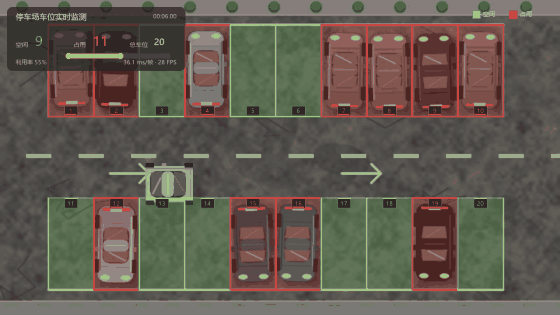
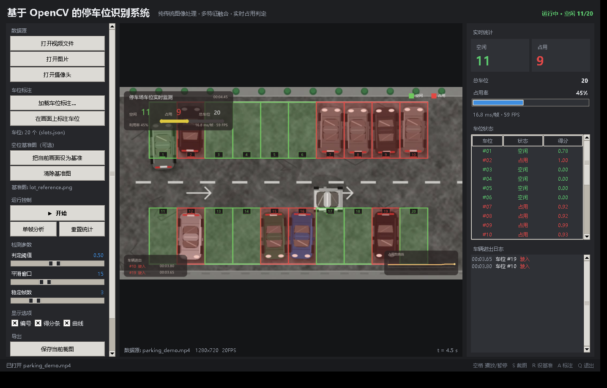
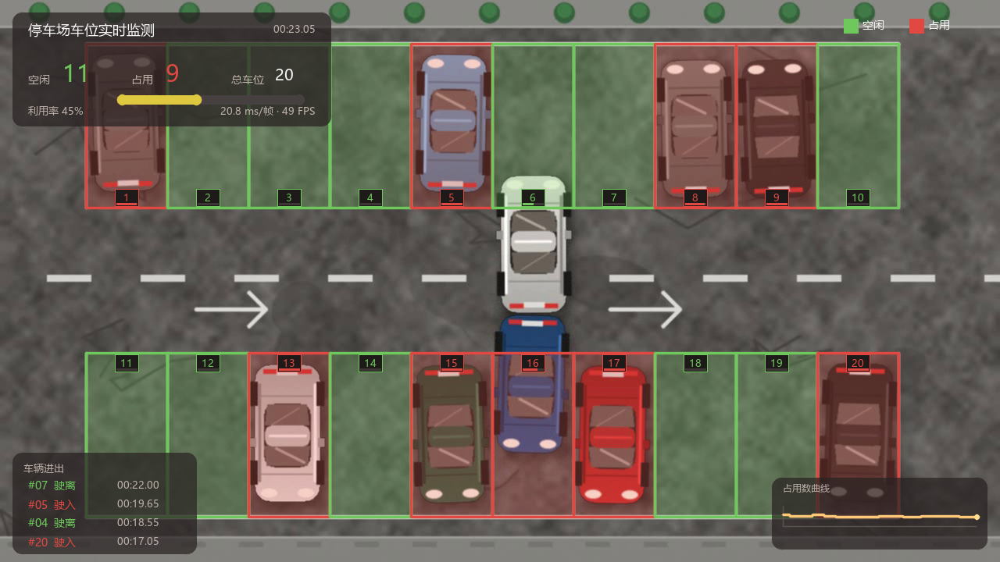

# 基于 OpenCV 的停车位识别系统


一套**纯传统图像处理**（不含任何深度学习）实现的停车场车位占用识别系统：
自动标注车位 → 逐车位提取多维图像特征 → 多特征加权融合打分 → 时间维滤波去抖
→ 实时可视化与统计报表。



> 演示：20 个车位实时占用判定，绿色=空闲、红色=占用（完整视频见 `data/parking_demo.mp4`）

## 30 秒速览

| 项目 | 内容 |
| --- | --- |
| **做什么** | 从监控画面中实时判定每个车位是空闲还是被占，输出空位数量、占用率曲线与车辆进出事件 |
| **技术路线** | 四点标注 + 透视矫正归一化 ROI → 6 维图像特征加权融合 → 时间维滤波去抖（**纯 OpenCV，无深度学习**） |
| **精度** | 自建带真值数据集（20 车位 / 840 帧）：正射与斜视角两组，准确率 / 精确率 / 召回率 / F1 **均 1.000** |
| **鲁棒性** | 9 类画质退化（噪声、模糊、JPEG 压缩、±光照、半分辨率、遮挡）下 F1 最低 **0.9974** |
| **性能** | 20 车位 @ 1280×720 单帧 **17–21 ms（≈50 FPS）**，CPU 单核实时，无需 GPU |
| **规模** | Python 约 4000 行 / 16 个模块，含标注工具、可视化界面、8 个子命令 CLI、评估与报告工具 |

```bash
pip install -r requirements.txt
python main.py gui        # 仓库自带演示数据，直接就能跑
```



> 上图：桌面主界面的实时运行画面（左：数据源与参数；中：检测叠加；右：统计、车位列表、进出日志）

---

## 一、功能一览

| 模块 | 能力 |
| --- | --- |
| 车位标注 | 鼠标点击四角即可定义车位，支持任意四边形（兼容斜视角/透视画面）、网格快速生成、删除与修改 |
| 检测算法 | 6 维特征（边缘密度、Otsu 类间方差、角点密度、灰度标准差、饱和度离散度、背景差分）加权融合 |
| 背景差分 | 可选"空场基准图"，并带**整体亮度补偿**与**相对化处理**，抵抗光照突变与雨雾 |
| 时间滤波 | 滑动窗口中值 + 迟滞门限 + 连续帧确认，彻底消除临界值抖动与状态闪烁 |
| 实时界面 | Tkinter 三栏界面：数据源切换、参数实时调节、车位状态列表、进出事件日志、性能指标 |
| 数据源 | 视频文件 / 单张图片 / USB 摄像头实时 |
| 报表导出 | 事件 CSV、状态 JSON、占用率曲线图、运行小结、参数配置 |
| 自动标定 | 用带真值的样本自动学习各特征的归一化区间、权重档位与判定阈值（网格搜索，不依赖 ML 库） |
| 精度评估 | 单帧/系统两套指标、阈值扫描曲线、9 种画质退化下的鲁棒性测试 |

## 二、运行环境

* Python 3.8 以上（本项目在 Python 3.14 + OpenCV 5.0 上验证）
* 依赖：`opencv-python`、`numpy`；中文文字渲染与界面需要 `Pillow` 和 `tkinter`（Python 自带）

```bash
pip install -r requirements.txt
```

> `opencv-python` 与 `numpy` 是必需的；`Pillow` 只影响画面上的中文文字，
> 缺少它时文字会自动降级成 `cv2.putText`（只能显示英文），检测与统计不受影响。

## 三、三步跑起来

```bash
# 第 1 步：装依赖（只需 OpenCV + NumPy；Pillow 用于画面中文，可选）
pip install -r requirements.txt

# 第 2 步：启动桌面界面（仓库已自带演示数据，界面会自动加载视频，点“开始”即可）
python main.py gui

# 第 3 步（可选）：看算法精度与鲁棒性
python main.py evaluate --data data --curve --robustness
```

> `data/` 里已经包含了合成好的演示数据，clone 下来即可直接跑。
> 想重新生成演示视频（约 2~3 分钟）：`python main.py demo`。

Windows 用户也可以直接双击 `run.bat`（默认进界面），
或 `run.bat evaluate --data data --curve --robustness`。

> 如果机器上有多个 Python，可以把装了 opencv 的那个解释器告诉脚本：
> `set PARKING_PYTHON=C:\path\to\.venv\Scripts\python.exe`，
> 之后再运行 `run.bat` 即可；也可以直接
> `C:\path\to\.venv\Scripts\python.exe main.py gui`。

**用你自己的监控画面**（3 步）：

1. `python main.py annotate --image 你的空场截图.png --out data/slots.json`
   在弹窗里把每个车位的四个角点出来（左键点 4 下 = 一个车位，S 保存）
2. 把视频放进 `data/`，然后
   `python main.py video --src 你的视频.mp4 --slots data/slots.json --reference data/空场截图.png`
3. 想长期用就把标注和参数固定下来，直接开界面：
   `python main.py gui --src 你的视频.mp4 --slots data/slots.json`

没有"空场基准图"也能用（此时自动只用前 5 个特征），但在界面里按 **R** 把某一帧设为
基准图，检测会更稳。

## 四、在 PyCharm 里运行

**第 1 步：打开项目**

`File → Open`，选择包含 `main.py` 的**文件夹**（不是单个 .py 文件），弹窗里选 *Open as Project*。

**第 2 步：选一个装了 OpenCV 的解释器**（关键）

`File → Settings`（`Ctrl+Alt+S`）→ `Project → Python Interpreter` →
选择/新建一个虚拟环境，并确保里面装了依赖：

```bash
pip install -r requirements.txt
```

如果运行时报 `ModuleNotFoundError: No module named 'cv2'`，说明选到了没装依赖的环境，
换一个即可。`main.py` 里做了依赖自检，会直接告诉你当前用的是哪个解释器、应该怎么办，
不会甩一长串 traceback。

> 同一台机器上如果已有装好 OpenCV 的虚拟环境，也可以直接沿用它：在
> `Add Interpreter → Add Local Interpreter → Existing` 里选中它的 `python.exe` 就行。
> 实在不想切环境，也可以把 `cv2`、`numpy`、`numpy.libs`、`PIL` 及其 `*.dist-info`
> 目录从有 OpenCV 的环境复制到目标环境的 `Lib\site-packages`
> （前提是两边 Python 大版本一致）。

**第 3 步：运行**

* **直接打开 `main.py`，点代码里 `if __name__ == "__main__":` 旁的绿色 ▶** ——
  不带参数运行会自动启动桌面界面
* 想跑评估：`Run → Edit Configurations`，在 `Parameters` 里填
  `evaluate --data data --curve`，`Working directory` 保持项目根目录
* 或者在 PyCharm 的 Terminal 里直接用命令行（见第九节）

小提示：

* 工作目录保持默认的项目根目录（配置里已写 `$PROJECT_DIR$`），否则会提示找不到 `data/slots.json`
* `Settings → Editor → File Encodings → 项目编码` 建议设为 `UTF-8`，控制台中文才不会乱码
* 界面跑起来后按 **空格** 开始播放；`Q` 或关窗口退出

## 五、界面操作

| 区域 | 说明 |
| --- | --- |
| 左栏 | 打开视频/图片/摄像头、加载或重新标注车位、设置空场基准图、运行控制、阈值与滤波参数、导出 |
| 中栏 | 检测叠加画面：绿=空闲、红=占用、编号标签底部小条为当帧得分 |
| 右栏 | 空闲/占用大数字、总车位、占用率进度条、单帧耗时与帧率、逐车位状态表、车辆进出日志 |
| 快捷键 | `空格` 播放/暂停、`S` 截图、`R` 设基准图、`A` 标注车位、`Q` 退出 |

参数含义：

* **判定阈值**：融合得分高于该值判为占用（默认 0.50，跟踪器的上下门限自动跟随 ±0.08）
* **平滑窗口**：中值滤波窗口帧数（默认 15 帧，越大越稳、越迟钝）
* **稳定帧数**：状态切换需要连续满足的帧数（默认 3）

## 六、算法原理



> 上图为单帧识别结果：绿色为确认空闲、红色为确认占用，车位编号下方细条是该车位当帧的融合得分，
> 左上角信息面板给出空闲/占用/总数/利用率与单帧耗时，左下角滚动显示车辆进出事件。

```
 ┌──────────┐   ┌──────────────┐   ┌──────────────┐   ┌────────────┐   ┌──────┐
 │ 读帧      │──▶│ 逐车位透视矫正 │──▶│ 6 维特征提取  │──▶│ 归一化+加权 │──▶│ 得分 │
 └──────────┘   └──────────────┘   └──────────────┘   └────────────┘   └──┬───┘
                                                                          │
        ┌─────────────────────────────────────────────────────────────────┘
        ▼
 ┌─────────────────┐   ┌──────────────┐   ┌──────────────┐
 │ 中值滤波+迟滞+稳定 │──▶│ 停车场状态管理 │──▶│ 可视化/统计/报表 │
 └─────────────────┘   └──────────────┘   └──────────────┘
```

### 1. 车位几何：任意四边形 + 透视矫正

车位用 4 个顶点描述，程序先按 `x+y` / `y-x` 极值自动排序为
左上→右上→右下→左下，再用 `cv2.getPerspectiveTransform` 把该四边形
矫正成固定尺寸（96×192）的正立 ROI。这样**正射俯视图和斜视角梯形车位
走完全相同的特征阈值**，同一套参数不用改。

顶点顺序还会被规整成"长边竖直"（`orient_portrait`），保证 2.4m×5.3m 的
纵向车位都落在同一个坐标约定里。

ROI 生成时同时按 8% 向内收缩（`inner_margin`），把白色车位线本身裁掉——
否则空车位的白线会给出极强的边缘/方差响应，直接破坏可分性。

### 2. 六维特征

| 特征 | 计算方式 | 物理含义 |
| --- | --- | --- |
| 边缘密度 | 自适应 Canny（阈值取自图像中值）后统计边缘像素占比 | 车体轮廓、车窗、车灯带来大量边缘 |
| Otsu 类间方差 | 64 bin 直方图的最大类间方差 ÷ 255² | "暗车身 + 亮地面"形成的双峰程度 |
| 角点密度 | `cornerMinEigenVal` 绝对阈值 + 连通域计数 | 车灯、车牌、车窗直角等强角点 |
| 灰度标准差 | ROI 灰度标准差 | 车身明暗反差远大于平整地面 |
| 饱和度离散度 | HSV 的 S 通道标准差 | 彩色车漆/塑料件的颜色聚集 |
| 背景差分 | 与空场基准图 ROI 的平均绝对差 | 最直接的证据（需基准图） |

> 角点特征特意没有用 `cv2.goodFeaturesToTrack`：它的 `qualityLevel` 是**相对**
> 当前画面最大特征值的比例，画面越平整反而越容易凑出一堆弱角点（饱和），
> 会让空车位的"角点数"比有车的还高。改成绝对阈值 + 连通域计数后单调性正常。

### 3. 归一化与加权融合

每个特征按标定区间 `(lo, hi)` 线性映射到 `[0, 1]`，再加权平均：

```
score = Σ wᵢ · norm(fᵢ) / Σ wᵢ
```

默认权重（有基准图时自动切换到第二组，背景差分占主导）：

| 场景 | edge | contrast | corner | std | sat | bgdiff |
| --- | --- | --- | --- | --- | --- | --- |
| 无基准图 | 0.30 | 0.26 | 0.20 | 0.14 | 0.10 | — |
| 有基准图 | 0.16 | 0.12 | 0.10 | 0.08 | 0.04 | 0.50 |

背景差分还做了两层抗干扰：

* **光照补偿**：当前帧/基准帧的平均亮度比，先把基准图按比例拉齐
* **相对化**：减去全场地面的差分中位数，把"全场变亮"和"这个车位有车"区分开

### 4. 时间维滤波

```
score ──▶ 15 帧滑动中值 ──▶ 迟滞判定 ──▶ 连续 3 帧确认 ──▶ 稳定状态
                              (占用≥0.58 / 释放≤0.42)
```

中值滤波压掉孤立尖峰；迟滞让"进"和"出"用不同门限，避免得分在阈值附近
反复横跳；连续帧确认再过滤掉行人遮挡、灯光扫过造成的瞬变。三者叠加后
车辆进出动画期间也不会出现状态闪烁。

### 5. 自动标定

`python main.py evaluate --calibrate` 会：

1. 用带真值的帧统计"空位/有车"两类特征分布
2. 每个特征的 `lo` 取空位 P85、`hi` 取有车 P15（重叠时自动放宽）
3. 在若干权重档位（默认档、均权档、单特征加强档）中网格搜索
4. 在得分轴上扫阈值选 F1 最优，若两类完全可分则取分隔带中点（最大裕度）

标定在**奇数帧**上训练、**偶数帧**上评估，避免自评自测。

## 七、精度评估结果

演示数据集（20 个车位 / 840 帧 / 42 秒 / 1280×720）：**单帧检测与系统输出均为 100%**
（过渡帧 ±0.8 秒不计入，避免惩罚滤波固有的响应延迟）。

```
  指标                  单帧检测             系统输出(含滤波)
  准确率               1.0000                1.0000
  精确率               1.0000                1.0000
  召回率               1.0000                1.0000
  F1                  1.0000                1.0000
  样本数               15568（帧数 × 车位数）
```

斜视角（透视梯形车位）数据集同样 100%，说明透视矫正这条路是通的。

### 鲁棒性测试（对画面施加退化后再检测）

| 测试条件 | 单帧准确率 | 系统准确率 | F1 |
| --- | --- | --- | --- |
| 原始画面 | 1.0000 | 1.0000 | 1.0000 |
| 高斯噪声 σ=12 | 1.0000 | 1.0000 | 1.0000 |
| 高斯模糊 7×7 | 1.0000 | 1.0000 | 1.0000 |
| 运动模糊 13px | 0.9952 | 0.9979 | 0.9974 |
| JPEG 质量 28 | 1.0000 | 1.0000 | 1.0000 |
| 亮度 −40% | 1.0000 | 1.0000 | 1.0000 |
| 亮度 +30% | 1.0000 | 1.0000 | 1.0000 |
| 半分辨率 | 1.0000 | 1.0000 | 1.0000 |
| 随机遮挡 | 1.0000 | 1.0000 | 1.0000 |

> 说明：演示数据由程序合成，车辆轮廓清晰，指标会高于真实监控（真实场景还要面对
> 夜间低照度、雨雪、树影、行人长时间遮挡等）。因此系统保留了
> `evaluate --calibrate` 与界面上的实时阈值滑块，换到自家摄像头后应先标定一次。

### 性能

单帧 20 个车位、1280×720：**约 17～21 ms/帧（≈50 FPS）**，其中检测占大头，
渲染约 4 ms。单核即可实时，无需 GPU。

## 八、目录结构

```
parking_system/
├── main.py                 统一入口（gui/video/image/camera/annotate/evaluate/demo/report）
├── run.bat                 Windows 一键启动
├── requirements.txt
├── LICENSE                 MIT
├── parking/
│   ├── config.py           全部可调参数、权重、配色、阈值同步
│   ├── slots.py            车位几何：四点排序、透视矫正、内缩、序列化
│   ├── features.py         6 维特征提取（纯 OpenCV 算子）
│   ├── detector.py         归一化 + 加权融合 + 阈值 + 自动标定
│   ├── tracker.py          中值滤波 / 迟滞 / 稳定帧状态机
│   ├── manager.py          停车场状态、进出事件、CSV/JSON 导出
│   ├── render.py           检测结果可视化（色块、编号、面板、曲线）
│   ├── text.py             中文文字渲染（Pillow 批量绘制，缺失时降级 cv2）
│   ├── pipeline.py         ParkingAnalyzer：串起检测→滤波→统计→渲染
│   ├── sources.py          视频/图片/摄像头统一帧源（含后台线程预读）
│   ├── annotate.py         鼠标标注工具
│   ├── gui.py              桌面主界面
│   ├── cli.py              命令行子命令
│   ├── demo.py             合成停车场数据生成器
│   ├── evaluate.py         精度评估、阈值扫描、鲁棒性测试
│   └── report.py           占用率曲线与报告输出
├── tools/                  辅助脚本
│   ├── analyze_features.py 特征可分性诊断（空位/有车两类均值与 AUC）
│   ├── make_gif.py         从演示视频生成 README 用的 GIF
│   ├── capture_gui.py      Win32 PrintWindow 截取界面（做文档配图）
│   ├── restore_demo_slots.py 还原被覆盖的演示车位标注
│   └── count_loc.py        统计代码规模
├── docs/                   文档配图（演示 GIF、界面截图、结果图）
├── data/                   演示数据（也可用 python main.py demo 重新生成）
│   ├── parking_demo.mp4        正射俯视演示视频（20 车位 / 42 秒 / 840 帧）
│   ├── parking_persp.mp4       斜视角演示视频
│   ├── lot_reference.png       空场基准图
│   ├── slots.json              车位标注（20 个车位）
│   ├── ground_truth.json       逐帧真值（0 空闲 / 1 占用 / 2 过渡忽略）
│   └── ...
└── output/                 运行产物：截图、事件 CSV、指标 JSON、报表（已 gitignore）
```

## 九、命令行参考

```bash
python main.py gui                      # 桌面界面
python main.py video   --src v.mp4 --slots data/slots.json [--save out.mp4] [--headless]
python main.py image   --src f.png --slots data/slots.json
python main.py camera  --index 0 --slots data/slots.json
python main.py annotate --image ref.png --out data/slots.json
python main.py evaluate --data data [--calibrate] [--curve] [--robustness] [--save-config cfg.json]
python main.py report   --data data     # 样例帧 + 占用率曲线 + 小结 + 事件 CSV
python main.py demo   [--perspective]   # 重新生成演示数据
```

通用参数：`--reference 空场图.png` 指定基准图，`--config cfg.json` 载入标定好的参数。

## 十、常见问题

**Q：为什么有的车位死活检测不出来？**
先看 `data/slots_overlay.png`（标注可视化）确认车位框是否贴合；再打开界面看该车位的
"得分"列——若占用时得分只有 0.2～0.4，说明该车位的归一化区间偏了，跑一次
`evaluate --calibrate --save-config output/config.json` 再 `--config` 载入即可。

**Q：车位标注尺寸和视频分辨率不一致怎么办？**
程序会打印警告。车位坐标是像素坐标，换分辨率必须重新标注（界面里点"在画面上标注车位"）。

**Q：夜间/逆光效果差？**
建议开启空场基准图（背景差分通道权重最大，对亮度变化也最稳），并适当降低判定阈值。

**Q：能不能上深度学习？**
可以，本系统的 `detector.py` 是个干净的插拔点：把 `SlotDetector.detect` 换成
CNN 分类器即可，后面的跟踪、统计、报表、界面完全复用。

## 十一、可扩展方向

* 车位线自动检测（Hough 直线聚类 + 四边形拟合）替代手工标注
* 车牌识别（`cv2.dnn` 加载 LPRNet 等模型）用于车辆定位与反向寻车
* 多路摄像头拼接成一张停车场全景后再统一检测
* 把统计结果推到 MQTT / HTTP 接口，供大屏或小程序展示
* 导出历史占用率做停车需求预测

## 十二、许可

本项目采用 [MIT License](LICENSE)。

演示数据（`data/`）由 `parking/demo.py` 程序化合成，可自由使用；
若要用于真实停车场，请先把车位标注换成你自己的监控画面（见第三节）。

---

如果这个项目对你有帮助，欢迎点个 ⭐ Star。
